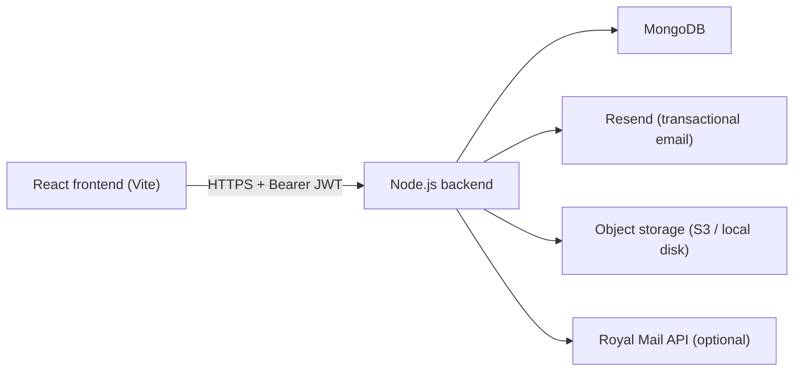

# Viron Labs Backend API Specification

> **Audience:** Backend engineers / AI agents building the Node.js + MongoDB
> server that this React frontend talks to.
>
> **This document is self-contained.** You do not need to read the frontend
> source to implement the backend — everything the frontend sends or expects
> is documented here.

---

## Table of Contents

1. [Project context](#1-project-context)
2. [Architecture overview](#2-architecture-overview)
3. [Global conventions](#3-global-conventions)
4. [MongoDB collection schemas](#4-mongodb-collection-schemas)
5. [Auth endpoints](#5-auth-endpoints)
6. [Generic table query endpoints](#6-generic-table-query-endpoints)
7. [RPC endpoints (business logic)](#7-rpc-endpoints-business-logic)
8. [Storage endpoints](#8-storage-endpoints)
9. [Functions endpoints](#9-functions-endpoints)
10. [Authorization matrix](#10-authorization-matrix)
11. [Business-logic reference](#11-business-logic-reference)
12. [Seed data](#12-seed-data)
13. [Security requirements](#13-security-requirements)
14. [Recommended tech stack](#14-recommended-tech-stack)
15. [Full implementation checklist](#15-full-implementation-checklist)
16. [Original Supabase / Postgres schema (reference)](#16-original-supabase--postgres-schema-reference)

---

## 1. Project context

Viron Labs is a UK e-commerce storefront selling research peptides. Payment
is by UK bank transfer (Faster Payments — sort code + account number), no
online card processing. Operational features include:

- Customer accounts with order history.
- Admin dashboard (stock, pricing, orders, reviews, promoters, settings).
- A rewards-points system (1 pt per £1, signup bonus, first-order bonus,
  redeem at checkout).
- A promoter / affiliate program (referral codes, customer discount, promoter
  commission banked as store credit).
- Abandoned-cart saving and reminder emails.
- Email notifications (order confirmation, payment received, shipped, tracking
  update, welcome, password reset, abandoned cart).
- Shipping cost tiers (Royal Mail Standard / Express / London drop-off).

The frontend is React + Vite. It talks to this backend through a thin,
Supabase-compatible shim at `src/lib/api/` (you don't need to look at it — the
shim's wire format is fully documented below).

---

## 2. Architecture overview



The frontend is a static SPA (deploy to Vercel / Netlify). The backend is an
Express (or Fastify) service. MongoDB holds all persistent data. Object
storage holds uploaded COA PDFs and product images. Resend handles outbound
email. Royal Mail API is optional — used for live shipping rate lookup;
falls back to fixed tiers if unavailable.

### Frontend → Backend communication model

The frontend emits **5 categories of requests** against fixed URL shapes:

| Category  | URL shape                                                 | Purpose                              |
| --------- | --------------------------------------------------------- | ------------------------------------ |
| Auth      | `POST/GET/PATCH /api/auth/*`                              | Sign up / in / out / reset / refresh |
| Query     | `POST /api/query/:table`                                  | Read rows from a collection         |
| Insert    | `POST /api/insert/:table`                                 | Create rows                          |
| Update    | `PATCH /api/update/:table`                                | Update rows                          |
| Upsert    | `POST /api/upsert/:table`                                 | Insert-or-update                     |
| Delete    | `DELETE /api/delete/:table`                               | Delete rows                          |
| RPC       | `POST /api/rpc/:name`                                     | Business logic / transactions        |
| Storage   | `POST /api/storage/:bucket/upload` + `GET /storage/:b/:p` | File upload + serve                  |
| Functions | `POST /api/functions/:name`                               | Email and other side-effect actions  |

The generic query endpoints are a PostgREST-style surface: one dispatcher parses
the request body and runs the corresponding MongoDB operation. The business-logic
endpoints (RPCs) are hand-written per-endpoint.

---

## 3. Global conventions

### 3.1 Base URL

Configured by the frontend via `VITE_API_URL`. Default for dev:
`http://localhost:4000`. Every endpoint below is mounted under this origin.

### 3.2 Content types

- Standard requests: `application/json` with UTF-8 bodies.
- Uploads: `multipart/form-data`.
- Responses: `application/json` except for storage file serving.

### 3.3 Authentication

- `Authorization: Bearer <access_token>` header on every protected endpoint.
- JWT recommended (HS256, 1-hour expiry). Opaque tokens work too as long as
  the refresh flow is supported.
- The frontend auto-refreshes once on any `401` using the stored
  `refresh_token`. If refresh fails, it signs the user out locally.
- Unauthenticated requests on protected endpoints return `401 Unauthorized`.
- Authenticated but insufficient role returns `403 Forbidden`.

### 3.4 Field naming — ALWAYS `snake_case`

All request bodies and response payloads use **`snake_case`** (e.g. `user_id`,
`created_at`, `is_active`, `order_number`, `shipping_cost`). This matches the
original Postgres schema and the frontend consumers. The Mongoose schemas
**must** serialize to snake_case. Recommended:

```js
// Each Mongoose schema:
schema.set('toJSON', {
  virtuals: true,
  versionKey: false,
  transform(_doc, ret) {
    ret.id = ret._id;
    delete ret._id;
    return ret;
  },
});
```

If you prefer camelCase internally, run `camelcase-keys`/`snakecase-keys`
through middleware — but never leak camelCase to the wire.

### 3.5 IDs

- Returned as strings.
- Recommended: UUID v4 (uuid package). Frontend passes these around as opaque
  strings — it does not parse or validate format.
- Mongo `_id` can also be ObjectId serialized to hex string. Either works.
- **Foreign keys** (e.g. `user_id`, `product_id`, `order_id`) are the referenced
  document's `id` as a string.

### 3.6 Dates / times

- ISO-8601 strings in UTC: `"2026-04-26T14:23:00.000Z"`.
- Keep the `_at` suffix from the SQL schema: `created_at`, `updated_at`,
  `paid_at`, `shipped_at`, `delivered_at`, `cancelled_at`.

### 3.7 Error response shape

Non-2xx responses **must** return:

```json
{
  "error": {
    "message": "Human-readable text shown directly to the user",
    "code": "optional_machine_code"
  }
}
```

Use appropriate HTTP status codes: `400 Bad Request`, `401 Unauthorized`,
`403 Forbidden`, `404 Not Found`, `409 Conflict` (e.g. duplicate unique key),
`422 Unprocessable Entity` (validation), `429 Too Many Requests`,
`500 Internal Server Error`.

**Keep messages user-safe** — they bubble directly into UI toasts.

### 3.8 Success response shape for reads

```json
{ "data": <T | null>, "count": <number | null> }
```

- `count` is non-null only when the caller requested a count (see §6.3).
- For `.single`, `data` is an object or `404`.
- For `.maybeSingle`, `data` is an object or `null`.
- Otherwise `data` is an array.

### 3.9 CORS

- Allow origin = frontend site (`CORS_ORIGIN` env var).
- Allow methods: `GET, POST, PATCH, PUT, DELETE, OPTIONS`.
- Allow headers: `Content-Type, Authorization`.
- Expose headers: `Content-Type, Authorization`.
- Allow credentials: **false** (frontend uses localStorage JWT, not cookies).

### 3.10 Money

- Stored and transmitted as `Number` (JSON number). Two-decimal precision.
- Always GBP. No multi-currency support.

---

## 4. MongoDB collection schemas

All collection names match the SQL table names verbatim (snake_case). The
frontend queries them by that name.

> **Note on array/JSON shapes.** Postgres `jsonb` columns (e.g. `orders.items`,
> `site_settings.value`, `admin_logs.details`) become plain nested objects /
> arrays in MongoDB. Postgres text arrays (`products.gallery_images`,
> `products.related_products`) become arrays of strings.

### 4.1 `users` (internal — replaces Supabase's `auth.users`)

```ts
{
  id: string,                      // uuid
  email: string,                   // unique, lowercased
  password_hash: string,           // bcrypt / argon2
  email_confirmed: boolean,        // false until user clicks confirmation link
  user_metadata: object,           // arbitrary — stores `role`, `full_name`, `referrer_id`, `notifications`, etc.
  app_metadata: object,            // reserved for backend-only fields
  last_sign_in_at: string | null,
  created_at: string,
  updated_at: string
}
```

Notes:
- `user_metadata.role === 'admin'` → user is admin. Alternatively,
  `profiles.is_admin === true` also flags admin — **either** must be checked.
- `user_metadata.full_name` is set during sign-up from the form.
- When a user is created the backend MUST also create a `profiles` row with
  `id = users.id` (see §4.2) and insert a `signup` row into `user_points`
  with `points = 50`.

### 4.2 `profiles`

Mirrors Postgres `public.profiles`. One row per user; `id` equals `users.id`.

```ts
{
  id: string,                      // uuid, PK, === users.id
  email: string,                   // snapshot of users.email
  full_name: string | null,
  phone: string | null,
  avatar_url: string | null,
  is_admin: boolean,               // default false
  is_banned: boolean,              // default false
  ban_reason: string | null,
  email_notifications: boolean,    // default true
  sms_notifications: boolean,      // default false
  marketing_emails: boolean,       // default false
  created_at: string,
  updated_at: string
}
```

### 4.3 `products`

```ts
{
  id: string,                      // uuid
  name: string,
  slug: string,                    // unique, URL-safe
  category: string,                // default "Popular"; values include "best-seller", "high-popularity", "essentials"
  description: string,
  short_description: string | null,
  image: string,                   // URL or root-relative path
  gallery_images: string[],        // default []
  review_count: number,            // default 0
  average_rating: number,          // default 5.0, CHECK 0..5
  is_active: boolean,              // default true
  is_featured: boolean,            // default false
  meta_title: string | null,
  meta_description: string | null,
  related_products: string[],      // array of product UUIDs
  badge: string | null,
  display_order: number,           // default 0 — ascending sort for storefront
  coa_url: string | null,          // Certificate of Analysis PDF URL
  more_info: string,               // long descriptive text, default fallback disclaimer

  // Stripe mirror — populated by the Product pre-save hook when Stripe is
  // configured. Per-dosage Price IDs live on `product_dosages.stripe_price_id`.
  stripe_product_id: string | null,

  created_at: string,
  updated_at: string
}
```

Index: `{ slug: 1 }` unique. Also `{ is_active: 1, display_order: 1 }`, `{ stripe_product_id: 1 }`.

**Stripe sync behaviour (pre-save hook on Product):**

* On `save()`, if any of `name`, `description`, `short_description`, `image`,
  `is_active`, `slug` changed (or `stripe_product_id` is empty), the hook
  calls `stripe.products.create` or `stripe.products.update` and writes the
  returned id back to `stripe_product_id` BEFORE the document is persisted.
* All Stripe errors are swallowed so a misconfigured Stripe account cannot
  block admin saves — the next save retries the sync.
* The hook is a no-op when `STRIPE_SECRET_KEY` is not set.

### 4.4 `product_dosages`

```ts
{
  id: string,                      // uuid
  product_id: string,              // FK → products.id
  mg: number,                      // dosage in mg (or arbitrary unit per `unit` field)
  unit: string,                    // default "MG"
  in_stock: boolean,               // default true
  stock_quantity: number,          // default 100
  low_stock_threshold: number,     // default 10
  sku: string | null,
  original_price: number | null,   // the "base" price — bundle pricing is computed from this
  originalPrice: number | null,    // legacy camelCase duplicate (same as original_price) — write both on insert for compat

  // Stripe mirror — latest Stripe Price ID for this dosage. Prices on Stripe
  // are immutable, so when the amount changes the old price is archived
  // (set inactive) and a new one is created.
  stripe_price_id: string | null,

  created_at: string,
  updated_at: string
}
```

Index: `{ product_id: 1 }`, `{ stripe_price_id: 1 }`.

**Stripe sync behaviour (pre-save hook on ProductDosage):**

* On `save()`, if `price` / `original_price` / `mg` / `unit` changed (or
  `stripe_price_id` is empty) the hook ensures the parent product has a
  `stripe_product_id`, then retrieves the existing Stripe Price (if any).
  If the unit amount or currency differs, the old price is set `active:false`
  and a brand-new price is created under the same Stripe Product.
* Same "best effort — never block the save" policy as `Product`.

### 4.5 `orders`

```ts
{
  id: string,                      // uuid
  order_number: string,            // unique 8-char alphanumeric (no prefix). See §7.1 generate_order_number.
  user_id: string | null,          // nullable — guest checkout supported
  customer_email: string,
  customer_first_name: string,
  customer_last_name: string,
  customer_phone: string | null,
  items: Array<{                   // jsonb in Postgres
    product_id: string,
    name: string,
    dosage: string,
    quantity: number,
    price: number,
    is_free: boolean
  }>,
  subtotal: number,
  shipping_cost: number,           // default 0
  discount_amount: number,         // default 0 (points + affiliate discounts combined)
  discount_code: string | null,
  tax_amount: number,              // default 0
  points_redeemed: number,         // default 0
  total: number,
  status:
    | 'pending_payment'            // default
    | 'payment_received'
    | 'processing'
    | 'shipped'
    | 'delivered'
    | 'cancelled'
    | 'refunded',
  payment_status:
    | 'pending'                    // default
    | 'received'
    | 'confirmed'
    | 'failed',
  payment_method: 'stripe' | 'bank_transfer',  // default 'stripe'

  // Stripe references — populated when payment_method === 'stripe'. All
  // three fields are null on bank-transfer orders. Webhook handlers fill in
  // `stripe_payment_intent_id` / `stripe_charge_id` when Stripe reports them.
  stripe_session_id: string | null,
  stripe_payment_intent_id: string | null,
  stripe_charge_id: string | null,
  shipping_address: string,
  shipping_suburb: string,
  shipping_state: string,
  shipping_postcode: string,
  shipping_method: string,         // e.g. "Royal Mail Standard", "Royal Mail Express"
  tracking_number: string | null,
  tracking_carrier: string,        // default 'Royal Mail'
  admin_notes: string | null,
  customer_notes: string | null,
  confirmation_email_sent: boolean, // default false
  payment_email_sent: boolean,      // default false
  shipped_email_sent: boolean,      // default false
  delivered_email_sent: boolean,    // default false
  age_verified: boolean,            // default false
  affiliate_code: string | null,
  affiliate_discount: number,       // default 0
  created_at: string,
  updated_at: string,
  paid_at: string | null,
  shipped_at: string | null,
  delivered_at: string | null,
  cancelled_at: string | null
}
```

Index: `{ order_number: 1 }` unique. `{ user_id: 1, created_at: -1 }`.
`{ customer_email: 1 }` for track-order lookups.

### 4.6 `reviews`

```ts
{
  id: string,                      // uuid
  user_id: string | null,
  product_id: string,              // FK → products.id
  order_id: string | null,
  rating: number,                  // 1..5
  title: string | null,
  comment: string | null,
  is_verified_purchase: boolean,
  is_approved: boolean,            // default false (admin moderates)
  is_featured: boolean,
  helpful_count: number,           // default 0
  admin_response: string | null,
  admin_responded_at: string | null,
  created_at: string,
  updated_at: string
}
```

Index: `{ product_id: 1, is_approved: 1 }`. `{ user_id: 1, created_at: -1 }`.

### 4.7 `user_points` (append-only event log)

**Balance is never stored** — it is always derived by summing `points` for a
user. See §11.2 for the points system.

```ts
{
  id: string,                      // uuid
  user_id: string,
  points: number,                  // positive or negative
  type: 'signup' | 'first_order' | 'purchase' | 'referral' | 'admin_adjustment' | 'redeemed' | 'revoked',
  description: string,
  order_id: string | null,         // set when related to an order
  created_at: string
}
```

Index: `{ user_id: 1, created_at: -1 }`. `{ order_id: 1, type: 1 }` for
idempotency checks in §7.5.

### 4.8 `user_points_v2` (duplicate of `user_points`)

Same schema. Exists for historical migration — the frontend reads from
`user_points` primarily. The backend SHOULD keep both in sync OR just treat
them as the same collection under two aliased routes. Simplest: write a route
alias so `/api/*/user_points_v2` transparently points to the `user_points`
collection.

### 4.9 `user_addresses`

```ts
{
  id: string,
  user_id: string,
  full_name: string,
  address_line1: string,
  address_line2: string | null,
  suburb: string,
  state: string,
  postcode: string,
  phone: string | null,
  is_default: boolean,             // default false
  label: string,                   // default "Home"
  created_at: string,
  updated_at: string
}
```

### 4.10 `user_carts`

Persistent cart per logged-in user.

```ts
{
  id: string,
  user_id: string,                 // UNIQUE — one row per user
  items: Array<{                   // jsonb
    productId: string,
    name: string,
    dosage: string,
    basePrice: number,
    price: number,
    originalPrice: number,
    quantity: number,
    image: string,
    isFree: boolean
  }>,
  email: string | null,
  reminder_sent: boolean,          // default false
  reminder_sent_at: string | null,
  updated_at: string
}
```

**Upsert contract**: the frontend uses `upsert({ user_id, items, updated_at }, { on_conflict: 'user_id' })`.
On conflict, **replace** the row (not merge).

### 4.11 `user_wishlists`

```ts
{
  id: string,
  user_id: string,
  product_id: string,
  dosage_id: string | null,
  created_at: string
}
```

### 4.12 `abandoned_carts`

Snapshot of carts for guest/anon visitors (not the logged-in `user_carts`).

```ts
{
  id: string,
  email: string | null,
  items: Array<{ /* same shape as user_carts.items */ }>,
  subtotal: number,
  reminder_sent: boolean,
  reminder_sent_at: string | null,
  recovered: boolean,
  recovered_at: string | null,
  created_at: string,
  updated_at: string
}
```

### 4.13 `promoters`

```ts
{
  id: string,
  user_id: string | null,          // linked auth user (nullable — admin can pre-create)
  name: string,
  email: string,                   // unique
  referral_code: string,           // unique, always upper-case
  commission_percent: number,      // default 10
  customer_discount_percent: number, // default 10
  tier: 'standard' | 'silver' | 'gold' | 'platinum',  // default 'standard'
  is_active: boolean,              // default true
  total_sales: number,             // aggregated — updated on each credited order
  total_orders: number,
  total_commission: number,
  store_credit: number,            // current balance
  created_at: string,
  updated_at: string
}
```

Tiers and commission auto-levelling (see §11.4):

| Tier     | Min total_sales | Commission % |
| -------- | --------------- | ------------ |
| standard | 0               | 10           |
| silver   | 1,000           | 12           |
| gold     | 5,000           | 15           |
| platinum | 15,000          | 20           |

Admin can override per-promoter.

### 4.14 `affiliate_orders`

```ts
{
  id: string,
  promoter_id: string,             // FK → promoters.id
  order_id: string,
  order_number: string,
  customer_email: string,
  order_total: number,
  commission_percent: number,      // snapshot at time of order
  commission_amount: number,
  customer_discount: number,       // default 0
  status: 'pending' | 'credited' | 'void', // default 'pending'
  credited_at: string | null,
  created_at: string
}
```

### 4.15 `store_credit_transactions`

Append-only ledger of promoter store credit changes.

```ts
{
  id: string,
  promoter_id: string,
  amount: number,                  // positive = add, negative = use
  type: 'commission' | 'adjustment' | 'used' | 'refund',
  description: string,
  order_id: string | null,
  created_at: string
}
```

Index: `{ promoter_id: 1, created_at: -1 }`.

### 4.16 `referrals`

```ts
{
  id: string,
  referrer_id: string,             // users.id who referred
  referred_user_id: string | null, // users.id who signed up
  referred_email: string,
  status: 'pending' | 'completed', // default 'completed'
  created_at: string,
  completed_at: string | null
}
```

### 4.17 `discount_codes`

```ts
{
  id: string,
  code: string,                    // unique, upper-case
  description: string | null,
  discount_type: 'percentage' | 'fixed_amount',
  discount_value: number,
  min_order_amount: number,        // default 0
  max_discount_amount: number | null,
  usage_limit: number | null,
  usage_count: number,             // default 0
  is_active: boolean,              // default true
  starts_at: string,
  expires_at: string | null,
  created_at: string,
  updated_at: string
}
```

### 4.18 `discount_code_usage`

```ts
{
  id: string,
  discount_code_id: string,
  user_id: string | null,
  order_id: string | null,
  discount_amount: number,
  used_at: string
}
```

### 4.19 `site_settings`

Key-value store. `value` is a JSON object.

```ts
{
  key: string,                     // PK
  value: object,                   // jsonb
  updated_by: string | null,       // users.id
  updated_at: string
}
```

Known keys and expected `value` shapes (see §12 for seed defaults):
- `bank_details` — `{ account_name, sort_code, account_number, bank_name, reference_hint? }`
- `discount_settings` — `{ enabled, badge_text, show_percentage, badge_position, discount_enabled, discount_percentage, buy2_percentage, buy3_percentage }`
- `free_gift_settings` — `{ enabled, threshold, product_id, dosage, name }`
- `telegram_link` — `{ url }`
- `whatsapp_link` — `{ url }`
- `landing_page_settings` — `{ enabled }`

### 4.20 `faq_categories`

```ts
{
  id: string,
  name: string,
  slug: string,                    // unique
  sort_order: number,
  is_active: boolean,
  created_at: string
}
```

### 4.21 `faq_items`

```ts
{
  id: string,
  category_id: string,             // FK
  question: string,
  answer: string,
  sort_order: number,
  is_active: boolean,
  views: number,                   // default 0
  created_at: string,
  updated_at: string
}
```

### 4.22 `testimonials`

```ts
{
  id: string,
  name: string,
  product: string,
  rating: number,                  // 1..5 default 5
  comment: string,
  verified: boolean,               // default true
  likes: number,
  is_active: boolean,
  display_order: number,
  created_at: string,
  updated_at: string
}
```

### 4.23 `newsletter_subscribers`

```ts
{
  id: string,
  email: string,                   // unique
  is_active: boolean,              // default true
  subscribed_at: string,
  unsubscribed_at: string | null
}
```

### 4.24 `email_templates`

```ts
{
  id: string,
  name: string,                    // unique — referenced by the frontend (see §12.4)
  subject: string,                 // may include {placeholder} tokens
  html_content: string,
  text_content: string | null,
  is_active: boolean,
  created_at: string,
  updated_at: string
}
```

### 4.25 `pending_emails`

Queue for emails that failed to send (fallback from `send-email` function).

```ts
{
  id: string,
  to_email: string,
  subject: string,
  html_content: string,
  text_content: string | null,
  status: 'pending' | 'sent' | 'failed',
  created_at: string
}
```

### 4.26 `product_views`

Analytics.

```ts
{
  id: string,
  product_id: string,
  user_id: string | null,
  session_id: string | null,
  viewed_at: string
}
```

### 4.27 `daily_stats`

Pre-aggregated daily stats (populated by a cron or on-demand).

```ts
{
  id: string,
  date: string,                    // YYYY-MM-DD, unique
  orders_count: number,
  revenue: number,
  new_users: number,
  page_views: number,
  created_at: string
}
```

### 4.28 `admin_action_logs` and `admin_logs`

Two collections with slightly different shapes; both are append-only. The
frontend writes to `admin_logs` via the `log_admin_action` RPC but queries
`admin_action_logs` in some places. Backend should log to **both** to preserve
read compatibility:

```ts
// admin_action_logs
{
  id: string,
  admin_id: string,                // users.id
  action: string,
  target_type: string,
  target_id: string | null,
  details: object,                 // jsonb
  created_at: string
}

// admin_logs (superset)
{
  id: string,
  admin_id: string | null,
  admin_email: string | null,
  action: string,
  target_type: string,
  target_id: string | null,
  details: object,
  ip_address: string | null,
  user_agent: string | null,
  created_at: string
}
```

---

## 5. Auth endpoints

All auth responses use the same `session` / `user` shapes:

```jsonc
// user
{
  "id": "uuid",
  "email": "foo@bar.com",
  "user_metadata": { "full_name": "Foo Bar", "role": "admin", "referrer_id": null },
  "app_metadata": {},
  "created_at": "2026-04-26T14:23:00Z"
}

// session
{
  "access_token": "<jwt>",
  "refresh_token": "<opaque>",
  "expires_at": 1745596800,      // unix seconds
  "user": { /* user */ }
}
```

### 5.1 `POST /api/auth/signup` (public)

**Request:**
```json
{
  "email": "foo@bar.com",
  "password": "hunter2-long-enough",
  "data": { "full_name": "Foo Bar", "referrer_id": null },
  "email_redirect_to": "https://vironlabs.com/confirm"
}
```

**Behavior:**
1. Validate password strength (≥8 chars recommended).
2. Reject if `email` already exists → `409`.
3. Hash password with argon2id or bcrypt (cost≥12).
4. Create `users` row with `user_metadata = data`, `email_confirmed = false`.
5. Create `profiles` row with matching `id`, `email`, `full_name = data.full_name`.
6. Insert `user_points` row `{ user_id, points: 50, type: 'signup', description: 'Signup bonus' }`.
7. If `data.referrer_id` is set and is a valid user id, create a `referrals`
   row `{ referrer_id: data.referrer_id, referred_user_id: <new user>, referred_email, status: 'completed', completed_at: now }` and
   award 100 `referral` points to the referrer (same as `create_referral_and_award` RPC).
8. Optionally send a confirmation email with a link that hits
   `email_redirect_to?token=...` — backend verifies the token and sets
   `email_confirmed = true`.
9. Return `{ session, user }`.

**Response:**
```json
{ "session": { /* session or null if email confirmation required first */ }, "user": { /* user */ } }
```

### 5.2 `POST /api/auth/signin` (public)

**Request:** `{ "email", "password" }`

**Behavior:**
1. Look up user by email (case-insensitive).
2. Compare password with stored hash.
3. On failure: `401 { error: { message: "Invalid email or password" } }` (do
   not leak whether the email exists).
4. If `profiles.is_banned === true`: `403 { error: { message: "Account suspended" } }`.
5. Update `last_sign_in_at`.
6. Return `{ session, user }`.

### 5.3 `POST /api/auth/signout` (bearer)

Revoke refresh token(s) for the caller. Respond `204 No Content`. The
frontend clears localStorage regardless of response.

### 5.4 `GET /api/auth/session` (bearer)

Return the current session if the access token is still valid:

```json
{ "session": { /* session */ } }
```

Return `{ "session": null }` (with `200 OK`) if the token is invalid or
expired — do NOT return 401 here because this endpoint's whole job is to tell
the client whether they have a session.

### 5.5 `GET /api/auth/user` (bearer)

Return `{ "user": { /* user */ } }` or `{ "user": null }`.

### 5.6 `PATCH /api/auth/user` (bearer)

**Request:** `{ "email"?, "password"?, "data"? }`

**Behavior:**
- If `password` set: validate and update hash.
- If `email` set: update `users.email`. Optionally send a confirmation email
  to the new address.
- If `data` set: **shallow-merge** into `user_metadata` (not replace).
- If `email` or `password` changed, rotate the access token and return a new
  `session` alongside the updated `user`:

```json
{ "user": { /* ... */ }, "session": { /* new session */ } }
```

- Also sync `profiles.email` and `profiles.full_name` when those change.

### 5.7 `POST /api/auth/password/reset` (public)

**Request:** `{ "email", "redirect_to": "https://vironlabs.com/reset" }`

**Behavior:**
1. ALWAYS return `204 No Content` regardless of whether the email exists — this
   prevents account enumeration.
2. If the email exists, generate a single-use token (JWT with `purpose=reset`,
   1-hour expiry), construct `${redirect_to}?token=<token>`, and send it via
   the `send-email` function with template `password_reset`.
3. When the user hits `/reset` and the frontend calls `PATCH /api/auth/user`
   with `Authorization: Bearer <reset_token>` and `{ password: newPassword }`,
   the backend accepts reset-purpose tokens for password updates only.

### 5.8 `POST /api/auth/refresh` (public)

**Request:** `{ "refresh_token": "<opaque>" }`

Rotate tokens and return a new session. On failure, return 401 — the frontend
will log out.

---

## 6. Generic table query endpoints

One dispatcher handles all read/write operations. Route the path, parse the
JSON body, translate to a MongoDB operation.

### 6.1 Endpoints

| Op     | Method | Path                    |
| ------ | ------ | ----------------------- |
| SELECT | POST   | `/api/query/:table`     |
| INSERT | POST   | `/api/insert/:table`    |
| UPDATE | PATCH  | `/api/update/:table`    |
| UPSERT | POST   | `/api/upsert/:table`    |
| DELETE | DELETE | `/api/delete/:table`    |

`:table` is the collection name (e.g. `products`, `orders`).

### 6.2 Request body grammar (all endpoints share this schema)

```jsonc
{
  "select": "*, product_dosages(*)",    // columns to return (or nested relation). Default "*" for SELECT.
  "filters": [
    { "op": "eq",    "column": "is_active",  "value": true },
    { "op": "ilike", "column": "category",   "value": "essentials" },
    { "op": "neq",   "column": "status",     "value": "cancelled" }
  ],
  "order": [
    { "column": "display_order", "ascending": true,  "nulls_first": false },
    { "column": "created_at",    "ascending": false }
  ],
  "limit": 5,
  "single": "single",    // "single" → require 1 row; "maybeSingle" → 0 or 1
  "count":  "exact",     // or "planned" / "estimated"
  "head":   true,        // true → do not return rows, only count
  "rows":   [ { /* row objects */ } ],  // INSERT / UPSERT
  "values": { "status": "shipped" },     // UPDATE
  "on_conflict": "user_id",              // UPSERT — the unique field that triggers update
  "returning": true                      // INSERT / UPDATE / UPSERT: when true, send back the affected rows
}
```

Any field not present should be treated as absent. Sensible defaults:
- SELECT without `order` → no sort (or natural `_id` order).
- SELECT without `limit` → no limit.
- UPDATE without `returning` → return no data.

### 6.3 Filter operators

| op     | Meaning                               | Mongo equivalent                  |
| ------ | ------------------------------------- | --------------------------------- |
| `eq`   | equals                                | `{ column: value }`               |
| `neq`  | not equals                            | `{ column: { $ne: value } }`      |
| `gt`   | `>`                                   | `{ column: { $gt: value } }`      |
| `gte`  | `>=`                                  | `{ column: { $gte: value } }`     |
| `lt`   | `<`                                   | `{ column: { $lt: value } }`      |
| `lte`  | `<=`                                  | `{ column: { $lte: value } }`     |
| `like` | SQL LIKE (case-sensitive glob)        | regex from pattern                |
| `ilike`| SQL ILIKE (case-insensitive glob)     | `{ column: { $regex, $options: 'i' } }` |
| `is`   | exact match incl. null                | `{ column: value }`               |

The frontend currently uses only `eq`, `neq`, `ilike` — but implement them all
for future-proofing. `ilike` patterns use SQL-style `%` wildcards; convert to
regex. For `ilike` with no wildcards the pattern is treated as a full-string
case-insensitive match.

### 6.4 Nested selects (joins)

The `select` field may contain nested-relation syntax:

- `"*, product_dosages (*)"` — return every `products` field, plus an array of
  all `product_dosages` rows where `product_dosages.product_id = products.id`,
  attached as `product_dosages: [...]`.
- `"id, title, products(name)"` — return those top-level fields plus
  `products: { name: string }` keyed by `reviews.product_id`.
- `"*, promoters(name, referral_code)"` — attach one-to-one `promoters` by
  `affiliate_orders.promoter_id`.

Parse the string into `[topLevelCols..., nestedSpecs]`. Implement with
Mongoose `populate()` or `$lookup` stages. The nested collection name is the
segment before `(`.

**Relation mapping (memorize this — these are the joins the frontend uses):**

| Base table         | Nested spec                      | Foreign key on base table  | Arity  |
| ------------------ | -------------------------------- | -------------------------- | ------ |
| `products`         | `product_dosages(*)`             | `product_dosages.product_id` | 1:N   |
| `reviews`          | `products(name)`                 | `reviews.product_id`       | N:1    |
| `affiliate_orders` | `promoters(name, referral_code)` | `affiliate_orders.promoter_id` | N:1 |

### 6.5 Sort order and `nulls_first`

Honor `ascending` (default true) and `nulls_first` (default false). For MongoDB
use `collation` / pipeline sort as needed; put `null`s last when `nulls_first`
is false.

### 6.6 Response for SELECT

```json
{ "data": <row | row[] | null>, "count": <number | null> }
```

- `single: "single"` + no rows → `404 { error: { message: "Row not found" } }`.
- `single: "maybeSingle"` + no rows → `{ "data": null, "count": null }`.
- `head: true` → `{ "data": null, "count": <integer> }`.
- Otherwise `data` is always an array.

### 6.7 Response for writes

```json
{ "data": <row | row[] | null>, "count": null }
```

- `returning: true` → include the affected row(s) in `data` (array unless the
  caller also chained `.single`).
- `returning: false` → `data: null`.
- For INSERT `data` is the inserted row (apply defaults and transforms).
- For UPDATE `data` is each updated row, post-update.
- For UPSERT `data` is each resulting row (inserted or updated).

### 6.8 Worked examples

**1. Load all active products with dosages, ordered by display order:**

Request (POST `/api/query/products`):
```json
{
  "select": "*, product_dosages (*)",
  "filters": [{ "op": "eq", "column": "is_active", "value": true }],
  "order": [{ "column": "display_order", "ascending": true, "nulls_first": false }]
}
```

Response:
```json
{
  "data": [
    {
      "id": "...", "name": "BPC-157", "slug": "bpc-157",
      "product_dosages": [
        { "id": "...", "mg": 5, "original_price": 60, "in_stock": true, "...": "..." }
      ],
      "...": "..."
    }
  ],
  "count": null
}
```

**2. Count active profiles (for admin KPI):**

Request (POST `/api/query/profiles`):
```json
{ "select": "*", "count": "exact", "head": true }
```

Response: `{ "data": null, "count": 1247 }`

**3. Insert an order without returning:**

Request (POST `/api/insert/orders`):
```json
{ "rows": [{ "order_number": "ABCD1234", "customer_email": "x@y.com", "...": "..." }] }
```

Response: `{ "data": null, "count": null }` (status 201 recommended)

**4. Update order with tracking and return:**

Request (PATCH `/api/update/orders`):
```json
{
  "values": { "status": "shipped", "tracking_number": "AM12345", "shipped_at": "2026-04-26T10:00:00Z" },
  "filters": [{ "op": "eq", "column": "id", "value": "..." }],
  "returning": true,
  "single": "single"
}
```

Response: `{ "data": { /* updated row */ }, "count": null }`

**5. Upsert cart:**

Request (POST `/api/upsert/user_carts`):
```json
{
  "rows": [{ "user_id": "u1", "items": [...], "updated_at": "..." }],
  "on_conflict": "user_id"
}
```

Response: `{ "data": null, "count": null }`

### 6.9 Tables the frontend hits

Implement the dispatcher for every collection listed in §4. If the frontend
hits a table not in §4, return `404 { error: { message: "Unknown table: X" } }`.

---

## 7. RPC endpoints (business logic)

Each RPC is `POST /api/rpc/:name`. Request body is the params object. Response
body is `{ "data": <return-value> }` on success. Error → standard error body.

All RPCs require authentication unless noted. Admin-only RPCs are marked.

### 7.1 `generate_order_number`

**Params:** `{}`
**Auth:** public (called from guest checkout)
**Returns:** `string` — an 8-character alphanumeric code from the alphabet
`ABCDEFGHJKLMNPQRSTUVWXYZ23456789` (no I, O, 0, 1 to avoid ambiguity).
**Behavior:** Generate a random code. Loop until one is not present in
`orders.order_number`. Do not prefix with `PEP-`; the frontend adds display
formatting.

### 7.2 `get_order_id_by_number`

**Params:** `{ p_order_number: string, p_email: string }`
**Auth:** public
**Returns:** `string | null` — the order's `id` only if both `order_number`
AND `customer_email` (case-insensitive) match. Return `null` for mismatch —
**never** distinguish "wrong email" from "not found". This endpoint is used
right after guest checkout to attribute affiliate commissions.

### 7.3 `track_order`

**Params:** `{ p_order_number: string, p_email: string }`
**Auth:** public
**Returns:** Sanitized order summary, or `null` if no match (again, do not
leak existence).

```ts
{
  order_number: string,
  status: string,                  // pending_payment | processing | shipped | delivered | cancelled
  payment_status: string | null,
  created_at: string,
  paid_at: string | null,
  tracking_number: string | null,
  shipping_method: string | null,
  shipping_state: string | null,
  shipping_postcode: string | null,
  subtotal: number,
  shipping_cost: number,
  discount_amount: number,
  total: number,
  items: Array<{ name: string, dosage: string, quantity: number, is_free: boolean }>
}
```

`p_order_number` may be submitted with `PEP-` prefix or without — strip it
before lookup. Match by `(order_number, customer_email)` case-insensitive
email. Do not return PII fields like first/last name, address lines, phone.

### 7.4 `admin_get_all_users`

**Params:** `{}`
**Auth:** admin-only (`profiles.is_admin === true` OR `user_metadata.role === 'admin'`)
**Returns:**
```ts
Array<{
  id: string,
  email: string,
  full_name: string | null,
  is_admin: boolean,
  is_banned: boolean,
  ban_reason: string | null,
  created_at: string,
  last_sign_in_at: string | null
}>
```

Join `users` with `profiles`.

### 7.5 `update_user_points`

**Params:** `{ p_user_id, p_points, p_type, p_description, p_order_id? }`
**Auth:** authenticated + (self OR admin)
**Returns:** `null`

**Behavior:**
- Insert a row into `user_points` with the given fields.
- **Idempotency:** if `p_type === 'purchase'` AND `p_order_id` is set, check
  that no existing `user_points` row matches `{ order_id: p_order_id, type: 'purchase' }`
  before inserting. If one exists, return success (no-op) — this prevents
  double-awarding when both "Mark Paid" and "Add Tracking" fire.

### 7.6 `get_order_earned_points_sum`

**Params:** `{ p_order_id }`
**Auth:** admin-only
**Returns:** `number` — sum of `user_points.points` where
`order_id = p_order_id AND type = 'purchase'`. Used before revoking points on
cancel/delete.

### 7.7 `create_referral_and_award`

**Params:** `{ p_referrer_id, p_referred_user_id, p_referred_email, p_bonus_points }`
**Auth:** authenticated (backend-internal; usually invoked from signup flow)
**Returns:** `{ ok: boolean, error?: string }`

**Behavior:**
1. Validate `p_referrer_id !== p_referred_user_id` → reject with
   `{ ok: false, error: 'Self-referral not allowed' }`.
2. If a `referrals` row already exists with this
   `(referrer_id, referred_user_id)`, return `{ ok: true }` idempotently.
3. Insert into `referrals`:
   `{ referrer_id, referred_user_id, referred_email, status: 'completed', completed_at: now }`.
4. Insert `user_points` row for the referrer with
   `{ points: p_bonus_points, type: 'referral', description: 'Referral bonus: ${p_referred_email}', order_id: null }`.
5. Return `{ ok: true }`.

### 7.8 `log_admin_action`

**Params:** `{ p_admin_id, p_action, p_target_type, p_target_id, p_details }`
**Auth:** admin-only
**Returns:** `null`

Insert into `admin_action_logs` AND `admin_logs`. Capture `admin_email`,
`ip_address`, `user_agent` in `admin_logs` from the request context.

### 7.8a `admin_create_influencer`

**Params:**
`{ p_name, p_email, p_referral_code, p_commission_percent?: number, p_customer_discount_percent?: number }`  
- `p_referral_code`: alphanumeric (non-alphanumerics stripped), min length 2 after strip.

**Auth:** admin-only

**Returns:**
```ts
{
  ok: true,
  account_action: 'created' | 'linked',
  email_sent: boolean,
  promoter: { /* full promoter document fields incl. id, referral_code, etc. */ }
}
```

**Behavior:**
1. Reject if another `promoters` row already uses the same `referral_code` (case-insensitive) or `email` (case-insensitive).
2. If a `users` row exists for `p_email`, require that no `promoters` row is already linked to that `user_id`; then set `account_action` to `linked` and create the `promoters` row with `user_id` set.
3. If no user exists, generate a temporary password, create `users` + `profiles` (+ signup bonus points per signup flow), set `account_action` to `created`, then create `promoters`.
4. Send transactional email with promo code; new accounts also receive the temporary password. Include a password-set link:
   `{SITE_URL}/reset-password?token=<JWT reset token>` (same signing as `POST /api/auth/password/reset`).
5. Append `admin_action_logs` / `admin_logs` with action `create_influencer`.

**Errors:** `409` if code/email conflict or account already linked to an influencer profile.

### 7.9 `update_site_setting`

**Params:** `{ p_key, p_value, p_user_id }`
**Auth:** admin-only
**Returns:** `null`

Upsert `site_settings` by `key`. Set `updated_by = p_user_id` and
`updated_at = now()`.

### 7.10 `get_all_site_settings`

**Params:** `{}`
**Auth:** public (frontend reads on every page load for storefront config)
**Returns:** `Array<{ key: string, value: object }>` — every row in
`site_settings`.

### 7.11 `validate_affiliate_code`

**Params:** `{ p_code: string }`
**Auth:** public
**Returns:**
```ts
{
  valid: boolean,
  error?: string,
  promoter_id?: string,
  promoter_name?: string,
  discount_percent?: number    // the customer-side discount, e.g. 10 → 10% off
}
```

**Behavior:**
1. Look up `promoters` by `referral_code` case-insensitive.
2. If not found OR `is_active === false` → `{ valid: false, error: 'Code not found or inactive' }`.
3. Otherwise return the promoter data.

The frontend separately checks if the current authed user is the promoter
themselves (self-referral block) using `promoters.user_id` vs
`users.id` and `promoters.email` vs `users.email`.

### 7.12 `record_affiliate_order`

**Params:** `{ p_promoter_id, p_order_id, p_order_number, p_customer_email, p_order_total, p_customer_discount }`
**Auth:** public (invoked right after guest checkout)
**Returns:** `{ ok: boolean, commission?: number, error?: string }`

**Behavior:**
1. Fetch the promoter. Reject if inactive.
2. Reject self-referral: if `promoter.email === p_customer_email` or
   `promoter.user_id === orders.user_id` → `{ ok: false, error: 'Self-referral not allowed' }`.
3. Check idempotency: if an `affiliate_orders` row exists for `p_order_id`,
   return `{ ok: true, commission: <existing> }`.
4. Compute `commission_amount = round((p_order_total - p_customer_discount) * promoter.commission_percent / 100, 2)`.
5. Insert into `affiliate_orders` with `status: 'pending'`.
6. Do NOT credit the promoter yet — that happens via
   `credit_affiliate_commission` when admin marks the order paid.
7. Return `{ ok: true, commission: commission_amount }`.

### 7.13 `credit_affiliate_commission`

**Params:** `{ p_order_id }`
**Auth:** admin-only (called when order marked as paid)
**Returns:** `{ ok: boolean, credited?: number, error?: string }`

**Behavior:**
1. Fetch the `affiliate_orders` row for `p_order_id`. If none, return
   `{ ok: true, credited: 0 }` (order had no affiliate code).
2. If already `status: 'credited'`, return `{ ok: true, credited: <amount> }`.
3. Update `affiliate_orders.status = 'credited'`, `credited_at = now()`.
4. Increment `promoters.store_credit += commission_amount`.
5. Increment `promoters.total_sales += order_total`,
   `total_orders += 1`, `total_commission += commission_amount`.
6. Re-evaluate tier based on new `total_sales` (§11.4) and update if changed.
7. Insert a `store_credit_transactions` row
   `{ promoter_id, amount: +commission_amount, type: 'commission', description: 'Order #<n>', order_id: p_order_id }`.
8. Send `sendPromoterCommissionEmail` — the frontend does not call it directly,
   so the backend should invoke the `send-email` function internally with the
   template payload.
9. Return `{ ok: true, credited: commission_amount }`.

### 7.14 `adjust_store_credit`

**Params:** `{ p_promoter_id, p_amount, p_description }`
**Auth:** admin-only
**Returns:** `{ ok: boolean, new_balance?: number, error?: string }`

**Behavior:** Atomic: update `promoters.store_credit += p_amount` (can be
negative), insert `store_credit_transactions { type: 'adjustment' }`.

### 7.15 `use_store_credit`

**Params:** `{ p_promoter_id, p_amount, p_description? }`
**Auth:** authenticated + self (promoter using their own credit at checkout)
**Returns:** `{ ok: boolean, remaining?: number, error?: string }`

**Behavior:**
1. Fetch promoter. Fail if `store_credit < p_amount` with
   `{ ok: false, error: 'Insufficient store credit' }`.
2. Atomic: `store_credit -= p_amount`, insert
   `store_credit_transactions { amount: -p_amount, type: 'used' }`.
3. Return `{ ok: true, remaining: new_balance }`.

### 7.16 `increment_review_helpful`

**Params:** `{ review_id }`
**Auth:** authenticated
**Returns:** `null`

**Behavior:** `reviews.helpful_count += 1` where `id = review_id`. Consider
deduping by `(review_id, user_id)` to prevent spam — keep a simple
`review_helpful_marks` collection if you want idempotency.

---

## 8. Storage endpoints

Two buckets: `coa_file` (PDFs) and `product-images` (images).

### 8.1 `POST /api/storage/:bucket/upload`

**Auth:** admin-only
**Content-Type:** `multipart/form-data`
**Form fields:**
- `file` — binary
- `path` — suggested storage path (may be used verbatim or canonicalized)
- `upsert` — `"true"` or `"false"` (string in multipart)
- `cache_control` — optional, e.g. `"3600"`
- `content_type` — optional MIME override

**Behavior:**
1. Validate MIME type (`coa_file`: `application/pdf` only; `product-images`:
   `image/png`, `image/jpeg`, `image/webp`).
2. Enforce size limits (PDFs ≤10 MB, images ≤5 MB).
3. If `upsert=false` and file exists → `409`.
4. Save to local disk (`./storage/:bucket/:path`) OR push to S3.

**Response:**
```json
{ "data": { "path": "bpc-157-1714512345.png" }, "error": null }
```

### 8.2 `GET /storage/:bucket/:path` (no `/api` prefix)

Public endpoint. Serves the file with correct `Content-Type` and a
`Cache-Control` header. The URL the frontend builds is:

```
{VITE_API_URL}/storage/{bucket}/{path}
```

Both PDFs and images must be downloadable / displayable inline.

If you move storage behind a CDN, expose a new `VITE_STORAGE_URL` env var and
override the URL builder in the frontend — for now the API and storage share
an origin.

---

## 9. Functions endpoints

### 9.1 `POST /api/functions/send-email`

**Auth:** bearer (any authenticated user for self-sent emails like tracking;
but in practice this is invoked from internal flows. You may also gate this
behind admin for user-triggered bulk sends).

**Request:**
```json
{
  "to": "customer@example.com",
  "subject": "Your Viron Labs Order Confirmation - #ABCD1234",
  "html": "<!DOCTYPE html>...",
  "text": "Optional plain-text fallback"
}
```

**Behavior:**
1. Validate `to` is a valid email.
2. Send via Resend (use the API key stored server-side as `RESEND_API_KEY`).
3. On failure, insert into `pending_emails` with `status: 'pending'` — a
   cron can retry.
4. Return `{ "success": true, "id": "resend-msg-id" }` on success.

**Response:** `{ success: boolean, id?: string, error?: string }`

If you extend to other functions (e.g. `admin-export`, `newsletter-send`),
mount them under `/api/functions/:name` with the same pattern.

---

## 9b. Payments endpoints (Stripe)

The primary checkout flow runs through Stripe PaymentIntents + Elements. The legacy
bank-transfer flow is retained as a backup and takes over when
`PAYMENT_PROVIDER=bank_transfer` (env var on the server + `VITE_PAYMENT_PROVIDER`
on the frontend).

Required server env:

| Variable                 | Purpose                                                       |
| ------------------------ | ------------------------------------------------------------- |
| `PAYMENT_PROVIDER`       | `stripe` (default) or `bank_transfer`                         |
| `STRIPE_SECRET_KEY`      | `sk_...` — server-side API key                                |
| `STRIPE_WEBHOOK_SECRET`  | `whsec_...` — used to verify webhook signatures               |
| `STRIPE_CURRENCY`        | ISO 4217, default `gbp`                                       |
| `STRIPE_SUCCESS_URL`     | Optional checkout return URL override |
| `STRIPE_CANCEL_URL`      | Optional checkout cancel URL override |

### 9b.1 `POST /api/payments/stripe/payment-intent`

**Auth:** optional (guest checkout supported — when the bearer is present
the resulting order is tied to that user; when absent a guest order is
created with `user_id: null`).

**Request body:**
```json
{
  "customer_email": "buyer@example.com",
  "customer_first_name": "Ada",
  "customer_last_name": "Lovelace",
  "customer_phone": "+447000000000",
  "shipping_address": "10 Downing St",
  "shipping_suburb": "London",
  "shipping_state": "England",
  "shipping_postcode": "SW1A 2AA",
  "shipping_method": "express",
  "shipping_cost": 15,
  "subtotal": 220,
  "discount_amount": 10,
  "points_redeemed": 100,
  "total": 225,
  "age_verified": true,
  "customer_notes": "",
  "affiliate_code": "ADA10",
  "user_id": "uuid-or-null",
  "items": [
    {
      "product_id": "uuid",
      "dosage_id": "uuid",
      "name": "BPC-157",
      "dosage": "5mg",
      "price": 55,
      "quantity": 4,
      "is_free": false
    }
  ]
}
```

**Response (200):**
```json
{ "client_secret": "pi_..._secret_...", "payment_intent_id": "pi_...", "order_number": "ABCD1234", "order_id": "uuid" }
```

**Behaviour:**

1. Generate a unique `order_number` (same algorithm as §7.1).
2. Create an `orders` document with `status=pending_payment`,
   `payment_status=pending`, `payment_method=stripe`, all items + shipping
   + discount fields as provided by the client. Totals are taken as-is
   from the payload; the server does not recompute them.
3. If `affiliate_code` resolves to an active promoter, upsert an
   `affiliate_orders` row with `status=pending` so the webhook can mark it
   credited on payment.
4. Call `stripe.paymentIntents.create` with calculated order amount and
   metadata `{ order_id, order_number, user_id, affiliate_code }`.
5. Persist `stripe_payment_intent_id` onto the order.
6. Return `{ client_secret, payment_intent_id, order_number, order_id }`.
7. **This endpoint does NOT send any email.** Order-confirmation / payment-
    received emails are fired exclusively by the webhook handler so we only
    email customers after Stripe confirms the payment.

### 9b.2 `POST /payments/stripe/webhook`  ← note: NOT under `/api`

**Auth:** signature verification only (public-facing).

**Mounting requirements:** This route MUST be registered BEFORE the global
`express.json()` body parser using `express.raw({ type: 'application/json' })`.
Stripe signature verification is performed against the exact bytes sent,
not the parsed JSON. See `src/app.js` — the webhook router is mounted at
`/payments` before `app.use(express.json(...))`.

**Handled event types:**

| Event                                         | Action                                                                                                                                                                                                                            |
| --------------------------------------------- | --------------------------------------------------------------------------------------------------------------------------------------------------------------------------------------------------------------------------------- |
| `checkout.session.completed`                  | Idempotent. Find order by `metadata.order_number`. Transition `status: pending_payment → processing`, `payment_status: pending → confirmed`, set `paid_at`, `stripe_payment_intent_id`. Award purchase points, create redemption entry, credit affiliate commission, and send the order-confirmation email. |
| `checkout.session.async_payment_succeeded`    | Same as `session.completed` — bank-debit-style Stripe methods fire this instead.                                                                                                                                                  |
| `checkout.session.expired`                    | If still `pending_payment`, transition to `cancelled` and set `cancelled_at`.                                                                                                                                                     |
| `checkout.session.async_payment_failed`       | Same as `expired` — mark cancelled.                                                                                                                                                                                               |
| `payment_intent.payment_failed`               | Log only (Stripe retries are the source of truth; we don't flip order state on a failed-PI event because the session is the real record for Checkout).                                                                            |
| `charge.refunded`                             | Find the Checkout Session by `payment_intent`, then the order by metadata. Set `status=refunded` and send a refund email.                                                                                                         |

**Response:** `{ "received": true }` on success; `400` for signature
mismatch; `500` for handler exceptions (Stripe will automatically retry).

### 9b.3 Stripe CLI setup (local dev)

```bash
# 1. Install the Stripe CLI and log in.
stripe login

# 2. Forward test webhooks to your local backend:
stripe listen --forward-to http://localhost:4000/payments/stripe/webhook
# → copy the whsec_... secret it prints into STRIPE_WEBHOOK_SECRET.

# 3. (Optional) trigger a test event end-to-end:
stripe trigger checkout.session.completed
```

### 9b.4 Product ↔ Stripe sync (admin CRUD)

Every write to `products` / `product_dosages` (via the generic table
dispatcher in §6) runs through Mongoose `pre('save')` hooks that call
`stripe.products.upsert` / `stripe.prices.create`. See §4.3 / §4.4 for
details. Admins do not need to call any Stripe endpoint directly — saving
the Mongo document is enough.

---

## 10. Authorization matrix

"Admin" = `profiles.is_admin === true` OR `user_metadata.role === 'admin'`.

| Resource / op                                          | Public | Authed (self) | Admin |
| ------------------------------------------------------ | ------ | ------------- | ----- |
| `products` read, `product_dosages` read                | ✓      | ✓             | ✓     |
| `products` write, `product_dosages` write              |        |               | ✓     |
| `reviews` read (`is_approved=true`)                    | ✓      | ✓             | ✓     |
| `reviews` write (insert own)                           |        | ✓             | ✓     |
| `reviews` approve / delete / update                    |        |               | ✓     |
| `orders` insert (guest checkout)                       | ✓      | ✓             | ✓     |
| `orders` read (own only)                               |        | ✓             | ✓     |
| `orders` read (any)                                    |        |               | ✓     |
| `orders` update / delete                               |        |               | ✓     |
| `profiles` read (own)                                  |        | ✓             | ✓     |
| `profiles` update (own: only safe fields)              |        | ✓             | ✓     |
| `profiles` write (`is_admin`, `is_banned`)             |        |               | ✓     |
| `site_settings` read                                   | ✓      | ✓             | ✓     |
| `site_settings` write                                  |        |               | ✓     |
| `promoters` read                                       |        |               | ✓     |
| `promoters` write                                      |        |               | ✓     |
| `user_carts` CRUD (own)                                |        | ✓             |       |
| `user_addresses` CRUD (own)                            |        | ✓             |       |
| `user_wishlists` CRUD (own)                            |        | ✓             |       |
| `user_points` read (own)                               |        | ✓             | ✓     |
| `user_points` insert                                   |        |               | ✓ (via RPC only) |
| `affiliate_orders`, `store_credit_transactions` read   |        | ✓ (own promoter) | ✓ |
| `faq_*`, `testimonials`, `newsletter_subscribers`      | ✓ read | ✓ read        | ✓ write |
| All `/api/storage/*/upload`                            |        |               | ✓     |
| All `/api/rpc/*` admin-only (see §7)                   |        |               | ✓     |

Enforce this in **middleware**, not just the frontend. Any write to a table
not allowed at the caller's scope returns `403`.

---

## 11. Business-logic reference

### 11.1 Order lifecycle

```
pending_payment ──(Stripe webhook OR admin confirms payment)──▶ processing ──(admin adds tracking)──▶ shipped ──(delivered_at set)──▶ delivered
      │                                                                │
      └──(Stripe session expired / admin cancels)──────────────────────┴──▶ cancelled
```

Status transitions with side effects:

| Transition              | Side effects                                                                                                             |
| ----------------------- | ------------------------------------------------------------------------------------------------------------------------ |
| `pending_payment → processing` (Stripe `checkout.session.completed` webhook for Stripe orders, or admin marks paid for bank-transfer orders) | Set `paid_at = now`, `payment_status = 'confirmed'`. For Stripe orders: also store `stripe_payment_intent_id`. Award purchase points via `update_user_points` (type='purchase'). If first paid order, also award `first_order` 100pts. Credit affiliate commission via `credit_affiliate_commission`. Send `payment_received` email. All of this happens inside the webhook handler for Stripe orders — see §9b.2. |
| `processing → shipped` (admin adds tracking)      | Set `shipped_at`, `tracking_number`, `tracking_carrier`. Send `order_shipped` email. (Idempotency on points via §7.5.)   |
| `shipped → delivered`   | Set `delivered_at`. Optionally send `order_delivered` email (no flag collision).                                         |
| `* → cancelled`         | Set `cancelled_at`. If points were awarded for this order (§7.6 > 0), insert a matching negative `user_points` row with `type='revoked'`. Void affiliate commission. |

### 11.2 Points system

Balance is **always computed** as `SUM(points)` from `user_points` for that
user. No cached balance column.

| Event                  | Points       | Trigger                                                                                     |
| ---------------------- | ------------ | ------------------------------------------------------------------------------------------- |
| `signup`               | +50          | On sign-up (one row).                                                                       |
| `referral`             | +100         | When a referred user signs up. Inserted for the referrer.                                   |
| `first_order`          | +100         | On the user's first paid order (first `purchase` row being inserted for this user).         |
| `purchase`             | +floor(total) | On order paid. 1 point per £1 of `orders.total`, rounded down.                             |
| `admin_adjustment`     | any          | Admin grants or removes points manually.                                                    |
| `redeemed`             | negative     | User spends points at checkout (e.g. -100 for £10 off).                                     |
| `revoked`              | negative     | On order cancel/delete — mirror of the original `purchase` / `first_order` awards.          |

Redemption tiers (hardcoded in frontend, enforced by checkout):
- 100 points → £10 off
- 250 points → £30 off
- 500 points → £75 off

Minimum lifetime spend before redemption is £500 (the frontend gates this;
backend just processes whatever the order payload says).

### 11.3 Order number format

- Generated server-side by `generate_order_number` (§7.1).
- 8 random chars from `ABCDEFGHJKLMNPQRSTUVWXYZ23456789`.
- Unique across `orders.order_number`.
- No `PEP-` prefix — the frontend adds display formatting (strip any
  `PEP-` found in legacy data on read). `formatOrderNumberDisplay` in the
  frontend strips any leading `PEP-?` case-insensitive.

### 11.4 Affiliate / promoter logic

- **Referral code** — stored upper-case; matched case-insensitive.
- **Customer discount** — applied at checkout (reducing order total).
- **Promoter commission** — a % of `(order_total - customer_discount)`.
  Pending until the order is marked paid (admin action).
- **Commission → store credit** — each credited commission adds to
  `promoters.store_credit` and records a `store_credit_transactions` row.
- **Promoter uses store credit at checkout** — handled by `use_store_credit`.
- **Tier promotion** — on each `credit_affiliate_commission`, recompute
  `promoters.tier` from `total_sales` against the table in §4.13. If the
  admin has overridden commission_percent, respect it (don't overwrite).

### 11.5 Shipping cost

Frontend computes shipping based on `site_settings.discount_settings` and
optional Royal Mail API. Backend is passed the final `shipping_cost`
verbatim on order insert — no server-side recomputation required.

Fixed tiers for reference (from the frontend config):
- Free over £250 order
- Standard: £10
- Express: £15
- London drop-off: £50

---

## 12. Seed data

Seed these on first boot (idempotent — skip if the row exists).

### 12.1 `site_settings`

```jsonc
[
  {
    "key": "bank_details",
    "value": {
      "account_name": "Viron Labs Ltd",
      "sort_code": "00-00-00",
      "account_number": "00000000",
      "bank_name": "Bank TBD",
      "reference_hint": "Use your order number as payment reference"
    }
  },
  {
    "key": "discount_settings",
    "value": {
      "enabled": true,
      "badge_text": "SAVE",
      "show_percentage": true,
      "badge_position": "top-right",
      "discount_enabled": true,
      "discount_percentage": 20,
      "buy2_percentage": 5,
      "buy3_percentage": 10
    }
  },
  {
    "key": "free_gift_settings",
    "value": {
      "enabled": true,
      "threshold": 300,
      "product_id": "bac-water",
      "dosage": "3 mL",
      "name": "BAC Water"
    }
  },
  { "key": "telegram_link", "value": { "url": "https://t.me/vironlabs" } },
  { "key": "whatsapp_link", "value": { "url": "" } },
  { "key": "landing_page_settings", "value": { "enabled": true } }
]
```

### 12.2 `faq_categories` and `faq_items`

Seed with whatever default FAQ content the business wants. The frontend
renders whatever is active. Minimum: one category `general` with one item
so the FAQ page isn't empty.

### 12.3 First admin user

- Create one user manually via a CLI script:
  `node scripts/create-admin.js --email admin@vironlabs.com --password ***`
- The script creates the `users` row, the `profiles` row with
  `is_admin = true`, and the `user_points` signup row.

### 12.4 `email_templates`

The frontend currently builds branded HTML bodies in code (see
`src/lib/email.ts`). `email_templates` is consulted only when the env flag
`EMAIL_USE_SUPABASE_HTML_TEMPLATES` is true. Known template names:

| Name                     | Purpose                             | Placeholders supported                                         |
| ------------------------ | ----------------------------------- | -------------------------------------------------------------- |
| `order_confirmation`     | Order placed, awaiting payment      | `{order_number}`, `{total}`, `{shipping_address}`, `{sort_code}`, `{account}`, `{account_name}`, `{bank_name}` |
| `payment_received`       | Payment confirmed                   | `{order_number}`, `{total}`                                    |
| `order_shipped`          | Order shipped with tracking         | `{order_number}`, `{tracking_number}`, `{tracking_carrier}`, `{tracking_url}` |
| `order_tracking_update`  | On-demand status email (track page) | `{order_number}`, `{status}`, `{tracking_number}`, `{track_url}` |
| `signup_welcome`         | New account welcome                 | `{name}`, `{site_url}`                                         |
| `password_reset`         | Password reset link                 | `{reset_url}`                                                  |

Seed each as `is_active: true` with a minimal subject + HTML body. The
frontend will fall back to its in-code defaults when no template is found.

---

## 13. Security requirements

### 13.1 Passwords

- Hash with **argon2id** (`@node-rs/argon2`) or bcrypt (cost ≥12).
- Never return the hash in API responses.
- Minimum length 8 chars; do not enforce composition rules.

### 13.2 JWT

- Use a strong secret (`JWT_SECRET`, ≥64 random bytes). Rotate annually.
- Access token expiry: **1 hour**.
- Refresh token expiry: **30 days**. Store hashed refresh tokens in a
  `refresh_tokens` collection; rotate on each refresh.
- Sign with HS256 (shared secret) or RS256 (keypair). HS256 is fine for a
  single-service backend.

### 13.3 Rate limits

At minimum:
- `/api/auth/signup` — 5 / hour / IP
- `/api/auth/signin` — 10 / 15min / IP, additional 5 / 15min / email
- `/api/auth/password/reset` — 3 / hour / email
- `/api/rpc/track_order` — 20 / min / IP
- `/api/storage/*/upload` — 20 / min / admin
- All other endpoints — 100 / min / IP

Use `express-rate-limit` or equivalent with a Redis store (or the Mongo
collection if Redis is overkill).

### 13.4 Input validation

- Validate every request body against a schema (Zod / Joi). Reject unknown
  fields with `422`.
- For the generic query dispatcher, validate the body grammar from §6.2 and
  whitelist table names to those in §4.
- Sanitize `ilike` patterns (escape regex metacharacters except `%` / `_`).

### 13.5 SSRF / file-upload hardening

- On image upload, sniff the magic bytes, not just the `Content-Type` header.
- Reject SVG uploads (they can execute JS in browsers).
- Store uploaded files outside the document root; serve via a controlled route.

### 13.6 CORS

- Allow origin = only the frontend URL. No wildcard in production.
- Allow headers: `Content-Type, Authorization`.
- No credentials (JWT in header, not cookies).

### 13.7 Secrets

- Secrets live in backend `.env`, never frontend:
  - `MONGO_URL`
  - `JWT_SECRET`
  - `REFRESH_JWT_SECRET` (can be the same with a different `aud`)
  - `RESEND_API_KEY` — used for outbound mail
  - `CORS_ORIGIN`
  - `STORAGE_ROOT` or S3 creds
  - `ROYAL_MAIL_API_KEY` (optional)

---

## 14. Recommended tech stack

This is a suggestion — pick what you know.

- **Runtime:** Node.js 20 LTS
- **Framework:** Express 5 (or Fastify 4)
- **ORM / ODM:** Mongoose 8
- **Validation:** Zod 3
- **Auth:** jsonwebtoken + argon2
- **Upload:** multer (disk) or `@aws-sdk/client-s3`
- **Email:** `resend` npm package
- **Rate limit:** `express-rate-limit`
- **Logging:** pino + pino-http
- **Config:** dotenv + zod-validated env parsing
- **Test:** vitest + supertest
- **Deploy:** Fly.io / Railway / a VPS with Docker

Directory layout suggestion:

```
backend/
  src/
    config/env.ts
    db/mongoose.ts
    auth/
      middleware.ts
      routes.ts
      jwt.ts
    query/
      dispatcher.ts       # §6 generic read/write
      filters.ts
      nested.ts           # select string parser
    rpc/                  # one file per RPC in §7
    storage/
    functions/send-email.ts
    models/               # one Mongoose schema per §4 collection
      users.ts
      profiles.ts
      products.ts
      ...
    routes/index.ts       # wires everything up
  scripts/
    create-admin.ts
    seed-settings.ts
  .env
  package.json
  Dockerfile
```

---

## 15. Full implementation checklist

Tick through this list to be production-ready.

### Foundation
- [ ] Node project bootstrapped with TypeScript + strict mode
- [ ] MongoDB connection (`MONGO_URL`) with reconnect/retry
- [ ] Environment config loaded and validated on startup
- [ ] Global error handler returning §3.7 shape
- [ ] JSON body parser + `/api/storage/*/upload` multipart parser
- [ ] CORS middleware per §3.9
- [ ] Pino logger with request IDs

### Data layer — Mongoose models
- [ ] One model per collection in §4, with snake_case `toJSON` transform
- [ ] Indexes for every unique / frequent-query field
- [ ] Default values matching §4

### Auth (§5)
- [ ] `POST /api/auth/signup` (with signup-bonus points + optional referral + profile row)
- [ ] `POST /api/auth/signin`
- [ ] `POST /api/auth/signout`
- [ ] `GET  /api/auth/session`
- [ ] `GET  /api/auth/user`
- [ ] `PATCH /api/auth/user`
- [ ] `POST /api/auth/password/reset`
- [ ] `POST /api/auth/refresh`
- [ ] Bearer middleware that populates `req.user`
- [ ] Admin middleware that enforces §10

### Generic query dispatcher (§6)
- [ ] Table whitelist (reject unknown collections)
- [ ] Filter operator parsing for all nine ops in §6.3
- [ ] Nested-select parser for the three joins in §6.4
- [ ] Sort with `nulls_first`
- [ ] `count: 'exact'` + `head: true`
- [ ] `single` / `maybeSingle` semantics
- [ ] INSERT returning
- [ ] UPDATE returning
- [ ] UPSERT on `on_conflict`
- [ ] DELETE returning count

### RPCs (§7) — one endpoint each
- [ ] `generate_order_number` (collision-safe loop)
- [ ] `get_order_id_by_number`
- [ ] `track_order`
- [ ] `admin_get_all_users`
- [ ] `update_user_points` (with idempotency on purchase+order_id)
- [ ] `get_order_earned_points_sum`
- [ ] `create_referral_and_award` (self-referral block)
- [ ] `log_admin_action` (writes both admin_logs + admin_action_logs)
- [ ] `admin_create_influencer` (admin-only; link/create user + promoter + welcome email)
- [ ] `update_site_setting`
- [ ] `get_all_site_settings`
- [ ] `validate_affiliate_code`
- [ ] `record_affiliate_order` (idempotent, self-referral block)
- [ ] `credit_affiliate_commission` (tier recompute + promoter email)
- [ ] `adjust_store_credit`
- [ ] `use_store_credit`
- [ ] `increment_review_helpful`

### Storage (§8)
- [ ] `POST /api/storage/coa_file/upload` (PDF only, ≤10 MB)
- [ ] `POST /api/storage/product-images/upload` (PNG/JPG/WebP, ≤5 MB)
- [ ] `GET /storage/:bucket/:path` serves with correct MIME + cache headers

### Functions (§9)
- [ ] `POST /api/functions/send-email` — Resend integration + `pending_emails` fallback

### Security (§13)
- [ ] argon2id password hashing
- [ ] JWT access + refresh with rotation
- [ ] Rate limits on listed endpoints
- [ ] Zod validation on every request body
- [ ] File-upload MIME sniffing + SVG reject
- [ ] CORS locked to frontend origin

### Seed + admin scripts (§12)
- [ ] `scripts/seed.ts` — seeds `site_settings`, default FAQ, default templates
- [ ] `scripts/create-admin.ts` — bootstraps the first admin user

### Tests
- [ ] Smoke tests for each auth endpoint
- [ ] Dispatcher tests for select / insert / update / upsert / delete per table
- [ ] RPC tests (one per RPC, covering idempotency where applicable)
- [ ] `track_order` returns null for wrong email (enumeration guard)

### Deploy
- [ ] Dockerfile
- [ ] Health endpoint `GET /healthz` returning `{ ok: true }` (no auth)
- [ ] Production env vars set
- [ ] `VITE_API_URL` on the frontend pointed to the deployed origin

---

## 16. Original Supabase / Postgres schema (reference)

Kept verbatim so you can cross-check MongoDB models against the original
relational definitions. **Do not run this SQL** — it is reference only.

```sql
-- WARNING: This schema is for context only and is not meant to be run.
-- Table order and constraints may not be valid for execution.

CREATE TABLE public.abandoned_carts (
  id uuid NOT NULL DEFAULT gen_random_uuid(),
  email character varying,
  items jsonb NOT NULL DEFAULT '[]'::jsonb,
  subtotal numeric DEFAULT 0,
  reminder_sent boolean DEFAULT false,
  reminder_sent_at timestamp with time zone,
  recovered boolean DEFAULT false,
  recovered_at timestamp with time zone,
  created_at timestamp with time zone DEFAULT now(),
  updated_at timestamp with time zone DEFAULT now(),
  CONSTRAINT abandoned_carts_pkey PRIMARY KEY (id)
);

CREATE TABLE public.admin_action_logs (
  id uuid NOT NULL DEFAULT gen_random_uuid(),
  admin_id uuid NOT NULL,
  action text NOT NULL,
  target_type text NOT NULL,
  target_id uuid,
  details jsonb NOT NULL DEFAULT '{}'::jsonb,
  created_at timestamp with time zone NOT NULL DEFAULT now(),
  CONSTRAINT admin_action_logs_pkey PRIMARY KEY (id),
  CONSTRAINT admin_action_logs_admin_id_fkey FOREIGN KEY (admin_id) REFERENCES auth.users(id)
);

CREATE TABLE public.admin_logs (
  id uuid NOT NULL DEFAULT gen_random_uuid(),
  admin_id uuid,
  admin_email character varying,
  action character varying NOT NULL,
  target_type character varying NOT NULL,
  target_id character varying,
  details jsonb DEFAULT '{}'::jsonb,
  ip_address inet,
  user_agent text,
  created_at timestamp with time zone DEFAULT now(),
  CONSTRAINT admin_logs_pkey PRIMARY KEY (id),
  CONSTRAINT admin_logs_admin_id_fkey FOREIGN KEY (admin_id) REFERENCES auth.users(id)
);

CREATE TABLE public.affiliate_orders (
  id uuid NOT NULL DEFAULT gen_random_uuid(),
  promoter_id uuid NOT NULL,
  order_id uuid NOT NULL,
  order_number text NOT NULL,
  customer_email text NOT NULL,
  order_total numeric NOT NULL,
  commission_percent numeric NOT NULL,
  commission_amount numeric NOT NULL,
  customer_discount numeric NOT NULL DEFAULT 0,
  status text NOT NULL DEFAULT 'pending'::text,
  credited_at timestamp with time zone,
  created_at timestamp with time zone NOT NULL DEFAULT now(),
  CONSTRAINT affiliate_orders_pkey PRIMARY KEY (id),
  CONSTRAINT affiliate_orders_promoter_id_fkey FOREIGN KEY (promoter_id) REFERENCES public.promoters(id)
);

CREATE TABLE public.daily_stats (
  id uuid NOT NULL DEFAULT gen_random_uuid(),
  date date NOT NULL UNIQUE,
  orders_count integer DEFAULT 0,
  revenue numeric DEFAULT 0,
  new_users integer DEFAULT 0,
  page_views integer DEFAULT 0,
  created_at timestamp with time zone DEFAULT now(),
  CONSTRAINT daily_stats_pkey PRIMARY KEY (id)
);

CREATE TABLE public.discount_code_usage (
  id uuid NOT NULL DEFAULT gen_random_uuid(),
  discount_code_id uuid NOT NULL,
  user_id uuid,
  order_id uuid,
  discount_amount numeric NOT NULL,
  used_at timestamp with time zone DEFAULT now(),
  CONSTRAINT discount_code_usage_pkey PRIMARY KEY (id),
  CONSTRAINT discount_code_usage_discount_code_id_fkey FOREIGN KEY (discount_code_id) REFERENCES public.discount_codes(id),
  CONSTRAINT discount_code_usage_user_id_fkey FOREIGN KEY (user_id) REFERENCES auth.users(id),
  CONSTRAINT discount_code_usage_order_id_fkey FOREIGN KEY (order_id) REFERENCES public.orders(id)
);

CREATE TABLE public.discount_codes (
  id uuid NOT NULL DEFAULT gen_random_uuid(),
  code character varying NOT NULL UNIQUE,
  description text,
  discount_type character varying NOT NULL CHECK (discount_type::text = ANY (ARRAY['percentage'::character varying, 'fixed_amount'::character varying]::text[])),
  discount_value numeric NOT NULL,
  min_order_amount numeric DEFAULT 0,
  max_discount_amount numeric,
  usage_limit integer,
  usage_count integer DEFAULT 0,
  is_active boolean DEFAULT true,
  starts_at timestamp with time zone DEFAULT now(),
  expires_at timestamp with time zone,
  created_at timestamp with time zone DEFAULT now(),
  updated_at timestamp with time zone DEFAULT now(),
  CONSTRAINT discount_codes_pkey PRIMARY KEY (id)
);

CREATE TABLE public.email_templates (
  id uuid NOT NULL DEFAULT gen_random_uuid(),
  name character varying NOT NULL UNIQUE,
  subject character varying NOT NULL,
  html_content text NOT NULL,
  text_content text,
  is_active boolean DEFAULT true,
  created_at timestamp with time zone DEFAULT now(),
  updated_at timestamp with time zone DEFAULT now(),
  CONSTRAINT email_templates_pkey PRIMARY KEY (id)
);

CREATE TABLE public.faq_categories (
  id uuid NOT NULL DEFAULT gen_random_uuid(),
  name character varying NOT NULL,
  slug character varying NOT NULL UNIQUE,
  sort_order integer DEFAULT 0,
  is_active boolean DEFAULT true,
  created_at timestamp with time zone DEFAULT now(),
  CONSTRAINT faq_categories_pkey PRIMARY KEY (id)
);

CREATE TABLE public.faq_items (
  id uuid NOT NULL DEFAULT gen_random_uuid(),
  category_id uuid NOT NULL,
  question text NOT NULL,
  answer text NOT NULL,
  sort_order integer DEFAULT 0,
  is_active boolean DEFAULT true,
  views integer DEFAULT 0,
  created_at timestamp with time zone DEFAULT now(),
  updated_at timestamp with time zone DEFAULT now(),
  CONSTRAINT faq_items_pkey PRIMARY KEY (id),
  CONSTRAINT faq_items_category_id_fkey FOREIGN KEY (category_id) REFERENCES public.faq_categories(id)
);

CREATE TABLE public.newsletter_subscribers (
  id uuid NOT NULL DEFAULT gen_random_uuid(),
  email character varying NOT NULL UNIQUE,
  is_active boolean DEFAULT true,
  subscribed_at timestamp with time zone DEFAULT now(),
  unsubscribed_at timestamp with time zone,
  CONSTRAINT newsletter_subscribers_pkey PRIMARY KEY (id)
);

CREATE TABLE public.orders (
  id uuid NOT NULL DEFAULT gen_random_uuid(),
  order_number character varying NOT NULL UNIQUE,
  user_id uuid,
  customer_email character varying NOT NULL,
  customer_first_name character varying NOT NULL,
  customer_last_name character varying NOT NULL,
  customer_phone character varying,
  items jsonb NOT NULL DEFAULT '[]'::jsonb,
  subtotal numeric NOT NULL,
  shipping_cost numeric NOT NULL DEFAULT 0,
  discount_amount numeric DEFAULT 0,
  discount_code character varying,
  tax_amount numeric DEFAULT 0,
  points_redeemed integer DEFAULT 0,
  total numeric NOT NULL,
  status character varying DEFAULT 'pending_payment'::character varying CHECK (status::text = ANY (ARRAY['pending_payment'::character varying, 'payment_received'::character varying, 'processing'::character varying, 'shipped'::character varying, 'delivered'::character varying, 'cancelled'::character varying, 'refunded'::character varying]::text[])),
  payment_status character varying DEFAULT 'pending'::character varying CHECK (payment_status::text = ANY (ARRAY['pending'::character varying, 'received'::character varying, 'confirmed'::character varying]::text[])),
  payment_method character varying DEFAULT 'bank_transfer'::character varying,
  shipping_address text NOT NULL,
  shipping_suburb character varying NOT NULL,
  shipping_state character varying NOT NULL,
  shipping_postcode character varying NOT NULL,
  shipping_method character varying NOT NULL,
  tracking_number character varying,
  tracking_carrier character varying DEFAULT 'Royal Mail'::character varying,
  admin_notes text,
  customer_notes text,
  confirmation_email_sent boolean DEFAULT false,
  payment_email_sent boolean DEFAULT false,
  shipped_email_sent boolean DEFAULT false,
  delivered_email_sent boolean DEFAULT false,
  created_at timestamp with time zone DEFAULT now(),
  updated_at timestamp with time zone DEFAULT now(),
  paid_at timestamp with time zone,
  shipped_at timestamp with time zone,
  delivered_at timestamp with time zone,
  cancelled_at timestamp with time zone,
  age_verified boolean NOT NULL DEFAULT false,
  affiliate_code text,
  affiliate_discount numeric DEFAULT 0,
  CONSTRAINT orders_pkey PRIMARY KEY (id),
  CONSTRAINT orders_user_id_fkey FOREIGN KEY (user_id) REFERENCES auth.users(id)
);

CREATE TABLE public.product_dosages (
  id uuid NOT NULL DEFAULT gen_random_uuid(),
  product_id uuid NOT NULL,
  mg numeric NOT NULL,
  in_stock boolean DEFAULT true,
  stock_quantity integer DEFAULT 100,
  low_stock_threshold integer DEFAULT 10,
  sku character varying,
  created_at timestamp with time zone DEFAULT now(),
  updated_at timestamp with time zone DEFAULT now(),
  originalPrice numeric,
  unit text NOT NULL DEFAULT 'MG'::text,
  CONSTRAINT product_dosages_pkey PRIMARY KEY (id),
  CONSTRAINT product_dosages_product_id_fkey FOREIGN KEY (product_id) REFERENCES public.products(id)
);

CREATE TABLE public.product_views (
  id uuid NOT NULL DEFAULT gen_random_uuid(),
  product_id uuid NOT NULL,
  user_id uuid,
  session_id character varying,
  viewed_at timestamp with time zone DEFAULT now(),
  CONSTRAINT product_views_pkey PRIMARY KEY (id),
  CONSTRAINT product_views_product_id_fkey FOREIGN KEY (product_id) REFERENCES public.products(id),
  CONSTRAINT product_views_user_id_fkey FOREIGN KEY (user_id) REFERENCES auth.users(id)
);

CREATE TABLE public.products (
  id uuid NOT NULL DEFAULT gen_random_uuid(),
  name character varying NOT NULL,
  slug character varying NOT NULL UNIQUE,
  category character varying NOT NULL DEFAULT 'Popular'::character varying,
  description text NOT NULL,
  short_description text,
  image text NOT NULL,
  gallery_images ARRAY DEFAULT '{}'::text[],
  review_count integer DEFAULT 0,
  average_rating numeric DEFAULT 5.0 CHECK (average_rating >= 0::numeric AND average_rating <= 5::numeric),
  is_active boolean DEFAULT true,
  is_featured boolean DEFAULT false,
  meta_title character varying,
  meta_description text,
  related_products ARRAY DEFAULT '{}'::uuid[],
  created_at timestamp with time zone DEFAULT now(),
  updated_at timestamp with time zone DEFAULT now(),
  badge character varying,
  display_order integer DEFAULT 0,
  coa_url text,
  more_info text DEFAULT 'This product is for research purposes only...'::text,
  CONSTRAINT products_pkey PRIMARY KEY (id)
);

CREATE TABLE public.profiles (
  id uuid NOT NULL,
  email character varying NOT NULL,
  full_name character varying,
  phone character varying,
  avatar_url text,
  is_admin boolean DEFAULT false,
  is_banned boolean DEFAULT false,
  ban_reason text,
  email_notifications boolean DEFAULT true,
  sms_notifications boolean DEFAULT false,
  marketing_emails boolean DEFAULT false,
  created_at timestamp with time zone DEFAULT now(),
  updated_at timestamp with time zone DEFAULT now(),
  CONSTRAINT profiles_pkey PRIMARY KEY (id),
  CONSTRAINT profiles_id_fkey FOREIGN KEY (id) REFERENCES auth.users(id)
);

CREATE TABLE public.promoters (
  id uuid NOT NULL DEFAULT gen_random_uuid(),
  user_id uuid,
  name text NOT NULL,
  email text NOT NULL UNIQUE,
  referral_code text NOT NULL UNIQUE,
  commission_percent numeric NOT NULL DEFAULT 10,
  customer_discount_percent numeric NOT NULL DEFAULT 10,
  tier text NOT NULL DEFAULT 'standard'::text,
  is_active boolean NOT NULL DEFAULT true,
  total_sales numeric NOT NULL DEFAULT 0,
  total_orders integer NOT NULL DEFAULT 0,
  total_commission numeric NOT NULL DEFAULT 0,
  store_credit numeric NOT NULL DEFAULT 0,
  created_at timestamp with time zone NOT NULL DEFAULT now(),
  updated_at timestamp with time zone NOT NULL DEFAULT now(),
  CONSTRAINT promoters_pkey PRIMARY KEY (id),
  CONSTRAINT promoters_user_id_fkey FOREIGN KEY (user_id) REFERENCES auth.users(id)
);

CREATE TABLE public.referrals (
  id uuid NOT NULL DEFAULT gen_random_uuid(),
  referrer_id uuid NOT NULL,
  referred_user_id uuid,
  referred_email text NOT NULL,
  status text NOT NULL DEFAULT 'completed'::text CHECK (status = ANY (ARRAY['pending'::text, 'completed'::text])),
  created_at timestamp with time zone DEFAULT now(),
  completed_at timestamp with time zone,
  CONSTRAINT referrals_pkey PRIMARY KEY (id),
  CONSTRAINT referrals_referrer_id_fkey FOREIGN KEY (referrer_id) REFERENCES auth.users(id),
  CONSTRAINT referrals_referred_user_id_fkey FOREIGN KEY (referred_user_id) REFERENCES auth.users(id)
);

CREATE TABLE public.reviews (
  id uuid NOT NULL DEFAULT gen_random_uuid(),
  user_id uuid,
  product_id uuid NOT NULL,
  order_id uuid,
  rating integer NOT NULL CHECK (rating >= 1 AND rating <= 5),
  title character varying,
  comment text,
  is_verified_purchase boolean DEFAULT false,
  is_approved boolean DEFAULT false,
  is_featured boolean DEFAULT false,
  helpful_count integer DEFAULT 0,
  admin_response text,
  admin_responded_at timestamp with time zone,
  created_at timestamp with time zone DEFAULT now(),
  updated_at timestamp with time zone DEFAULT now(),
  CONSTRAINT reviews_pkey PRIMARY KEY (id),
  CONSTRAINT reviews_user_id_fkey FOREIGN KEY (user_id) REFERENCES auth.users(id),
  CONSTRAINT reviews_product_id_fkey FOREIGN KEY (product_id) REFERENCES public.products(id),
  CONSTRAINT reviews_order_id_fkey FOREIGN KEY (order_id) REFERENCES public.orders(id)
);

CREATE TABLE public.site_settings (
  key text NOT NULL,
  value jsonb NOT NULL,
  updated_by uuid,
  updated_at timestamp with time zone NOT NULL DEFAULT now(),
  CONSTRAINT site_settings_pkey PRIMARY KEY (key),
  CONSTRAINT site_settings_updated_by_fkey FOREIGN KEY (updated_by) REFERENCES auth.users(id)
);

CREATE TABLE public.store_credit_transactions (
  id uuid NOT NULL DEFAULT gen_random_uuid(),
  promoter_id uuid NOT NULL,
  amount numeric NOT NULL,
  type text NOT NULL,
  description text NOT NULL DEFAULT ''::text,
  order_id uuid,
  created_at timestamp with time zone NOT NULL DEFAULT now(),
  CONSTRAINT store_credit_transactions_pkey PRIMARY KEY (id),
  CONSTRAINT store_credit_transactions_promoter_id_fkey FOREIGN KEY (promoter_id) REFERENCES public.promoters(id)
);

CREATE TABLE public.testimonials (
  id uuid NOT NULL DEFAULT gen_random_uuid(),
  name text NOT NULL,
  product text NOT NULL,
  rating integer NOT NULL DEFAULT 5 CHECK (rating >= 1 AND rating <= 5),
  comment text NOT NULL,
  verified boolean NOT NULL DEFAULT true,
  likes integer NOT NULL DEFAULT 0,
  is_active boolean NOT NULL DEFAULT true,
  display_order integer NOT NULL DEFAULT 0,
  created_at timestamp with time zone NOT NULL DEFAULT now(),
  updated_at timestamp with time zone NOT NULL DEFAULT now(),
  CONSTRAINT testimonials_pkey PRIMARY KEY (id)
);

CREATE TABLE public.user_addresses (
  id uuid NOT NULL DEFAULT gen_random_uuid(),
  user_id uuid NOT NULL,
  full_name character varying NOT NULL,
  address_line1 character varying NOT NULL,
  address_line2 character varying,
  suburb character varying NOT NULL,
  state character varying NOT NULL,
  postcode character varying NOT NULL,
  phone character varying,
  is_default boolean DEFAULT false,
  label character varying DEFAULT 'Home'::character varying,
  created_at timestamp with time zone DEFAULT now(),
  updated_at timestamp with time zone DEFAULT now(),
  CONSTRAINT user_addresses_pkey PRIMARY KEY (id),
  CONSTRAINT user_addresses_user_id_fkey FOREIGN KEY (user_id) REFERENCES auth.users(id)
);

CREATE TABLE public.user_carts (
  id uuid NOT NULL DEFAULT gen_random_uuid(),
  user_id uuid NOT NULL UNIQUE,
  items jsonb NOT NULL DEFAULT '[]'::jsonb,
  email character varying,
  reminder_sent boolean DEFAULT false,
  reminder_sent_at timestamp with time zone,
  updated_at timestamp with time zone DEFAULT now(),
  CONSTRAINT user_carts_pkey PRIMARY KEY (id),
  CONSTRAINT user_carts_user_id_fkey FOREIGN KEY (user_id) REFERENCES auth.users(id)
);

CREATE TABLE public.user_points (
  id uuid NOT NULL DEFAULT gen_random_uuid(),
  user_id uuid NOT NULL,
  points integer NOT NULL,
  type text NOT NULL,
  description text NOT NULL DEFAULT ''::text,
  order_id uuid,
  created_at timestamp with time zone NOT NULL DEFAULT now(),
  CONSTRAINT user_points_pkey PRIMARY KEY (id),
  CONSTRAINT user_points_v2_user_id_fkey FOREIGN KEY (user_id) REFERENCES auth.users(id),
  CONSTRAINT user_points_v2_order_id_fkey FOREIGN KEY (order_id) REFERENCES public.orders(id)
);

CREATE TABLE public.user_points_v2 (
  id uuid NOT NULL DEFAULT gen_random_uuid(),
  user_id uuid NOT NULL,
  points integer NOT NULL,
  type text NOT NULL CHECK (type = ANY (ARRAY['signup'::text, 'first_order'::text, 'purchase'::text, 'admin_adjustment'::text, 'redeemed'::text, 'revoked'::text])),
  description text NOT NULL DEFAULT ''::text,
  order_id uuid,
  created_at timestamp with time zone NOT NULL DEFAULT now(),
  CONSTRAINT user_points_v2_pkey PRIMARY KEY (id),
  CONSTRAINT user_points_v2_user_id_fkey1 FOREIGN KEY (user_id) REFERENCES auth.users(id),
  CONSTRAINT user_points_v2_order_id_fkey1 FOREIGN KEY (order_id) REFERENCES public.orders(id)
);

CREATE TABLE public.user_wishlists (
  id uuid NOT NULL DEFAULT gen_random_uuid(),
  user_id uuid NOT NULL,
  product_id uuid NOT NULL,
  dosage_id uuid,
  created_at timestamp with time zone DEFAULT now(),
  CONSTRAINT user_wishlists_pkey PRIMARY KEY (id),
  CONSTRAINT user_wishlists_user_id_fkey FOREIGN KEY (user_id) REFERENCES auth.users(id),
  CONSTRAINT user_wishlists_product_id_fkey FOREIGN KEY (product_id) REFERENCES public.products(id),
  CONSTRAINT user_wishlists_dosage_id_fkey FOREIGN KEY (dosage_id) REFERENCES public.product_dosages(id)
);
```

---

**End of specification.** If anything here is ambiguous, default to the
behavior of the original Supabase schema — that is what the frontend was
tested against.
